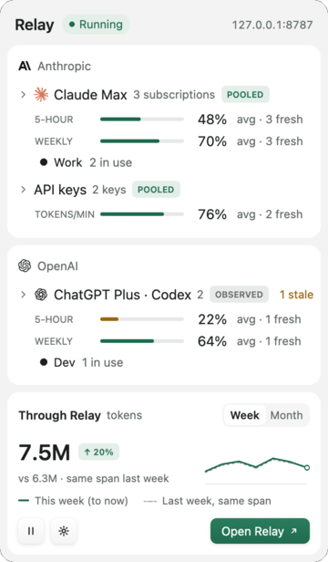
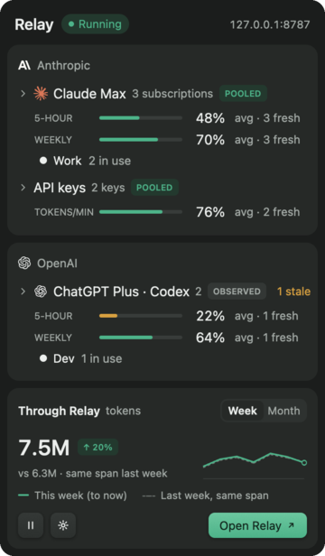
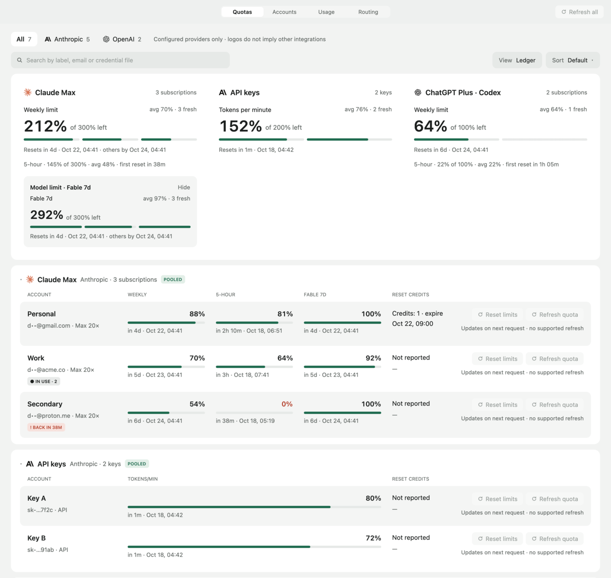

<p align="center">
  
</p>

<h1 align="center">Relay</h1>

<p align="center">
  A native menu-bar and tray app for macOS and Linux that routes Claude Code and Codex through your own accounts, and shows how much quota each one has left.
</p>

<p align="center">
  
  
</p>

<p align="center"><sub><b>Native GPUI render with sample data.</b> Rendered offscreen from Relay's own views; no live accounts. <a href="https://app.paper.design/file/01M58Z151ZVWZ4VVK921R3Q5J9/p-2-0">Approved design</a></sub></p>

> [!NOTE]
> Relay is early. The repository is private and no release has been published yet, so the public one-line installer below doesn't work yet. Installing needs the GitHub CLI logged in to an account with access to `dakdevs/relay`.

## What it does

Relay runs a local proxy on `127.0.0.1` that speaks the two APIs the stock CLIs already use: Anthropic Messages for Claude Code and OpenAI Responses for Codex. T3 Code, or any other harness, points a CLI at Relay; Relay forwards each request to the provider and records quota and token usage on the way back.

- **Quota at a glance.** The tray popover groups accounts by provider, then by plan or credential, with one bar per quota window (5-hour, weekly, model limits, API tokens per minute). Bars show quota left. Averages count only fresh data, and unknown values show as "—", never 0%.
- **Your accounts, your mode.** Each account is either **Observed** (the client keeps its own login; Relay records usage only), **Pooled** (opt-in; each new session goes to the account with the most headroom, and running sessions stay on their account), or an **API key** you configure. Relay never substitutes an API key for a subscription.
- **Cautious failover.** Relay moves a request to another account only when the first attempt provably never reached the provider or was explicitly rejected. It never retries automatically after an ambiguous failure, such as a connection lost after the request was sent. Clients such as Claude Code and Codex may still retry on their own.
- **Through Relay.** Input and output tokens that passed through Relay, by day, with week-over-week or month-over-month comparison.
- **Contained.** Relay forwards only to an allow-list of provider origins. Configuration names where a credential lives (environment variable, file or keychain) instead of storing it, and secrets are never logged.

<p align="center">
  
</p>
<p align="center"><sub><b>Native GPUI render with sample data</b> of the main window's Quotas ledger (cropped); no live accounts.</sub></p>

## Install

### Ask your coding agent

Paste this into Claude Code, Codex or another agent with a terminal:

```text
Install Relay from the private GitHub repository dakdevs/relay on this machine.
1. Check that the GitHub CLI is logged in (`gh auth status`). If it isn't, or it can't
   see dakdevs/relay, stop and tell me.
2. Make a new temporary directory and download the release installer into it:
   gh release download --repo dakdevs/relay --pattern install.sh --dir <that directory>
3. Read install.sh, then run it with bash. Don't use sudo. Don't pass --force unless I
   confirm replacing an existing installation. Don't launch Relay.
4. Report where Relay was installed and the output of `relay --version`
   (on macOS: ~/Applications/Relay.app/Contents/MacOS/relay --version).
```

### Or run it yourself

```sh
d="$(mktemp -d)" && gh release download --repo dakdevs/relay --pattern install.sh --dir "$d" && bash "$d/install.sh"
```

The installer:

- detects macOS or Linux and x86_64 or Arm, and downloads the matching archive with `gh`;
- checks it against the SHA-256 checksums embedded in that release's `install.sh`;
- rejects archives with links, `..` paths or unexpected files, and checks that the binary reports the expected version;
- installs into your home directory — `~/Applications/Relay.app` on macOS; `~/.local/bin/relay` plus a desktop entry and icons on Linux — and never uses `sudo`;
- refuses to replace an existing installation unless you pass `--force`.

Options: `--version vYYYYMMDD.N`, `--app-dir DIR` (macOS), `--prefix DIR` (Linux), `--from DIR` (archives you already downloaded). Run it with `--help` for details.

Once the repository is public, this will also work without `gh`:

```sh
curl -fsSL https://github.com/dakdevs/relay/releases/latest/download/install.sh | bash
```

### Platform notes

- **macOS 12 or later**, Apple Silicon or Intel. Builds are ad-hoc signed, **not** signed with a Developer ID and **not** notarized. The installer doesn't quarantine the app. If you download an archive with a browser instead, macOS blocks the first launch; open System Settings → Privacy & Security and choose Open Anyway.
- **Linux** x86_64 or aarch64 with glibc 2.35 or later (Ubuntu 22.04 or newer), a Vulkan driver, and a StatusNotifierItem host for the tray icon. GNOME needs the AppIndicator extension; without a host Relay opens its main window instead. Runtime requirements on Debian/Ubuntu, usually present on a desktop install: `libdbus-1-3 libfontconfig1 libfreetype6 libvulkan1 libwayland-client0 libx11-6 libx11-xcb1 libxcb1 libxkbcommon-x11-0 libxkbcommon0 libzstd1` ([list](release/linux/runtime-packages.txt)). Each release build checks that every library `relay` links directly comes from one of them; some, such as Vulkan and Wayland, may instead be loaded at run time.

## Configure

Relay keeps its files in `$RELAY_HOME` if set, otherwise `~/Library/Application Support/Relay` on macOS and `$XDG_CONFIG_HOME/relay` (default `~/.config/relay`) on Linux:

| File          | Contents                                                                                                   |
| ------------- | ---------------------------------------------------------------------------------------------------------- |
| `config.toml` | Accounts, routing and listener settings; names where each credential lives, never the secret. Mode `0600`. |
| `local-key`   | The key clients send to Relay, generated on first start. Mode `0600`.                                      |
| `usage.db`    | Token usage through Relay (SQLite).                                                                        |

With no `config.toml`, Relay starts with no accounts on `127.0.0.1:8787`. [`config.example.toml`](config.example.toml) shows every setting. The headless `relay-proxy` binary runs the same proxy without the app; `relay-proxy check` validates the configuration and reports which credentials are available, without creating files.

## Connect T3 Code

You create the T3 instances yourself; Relay never edits T3 or CLI settings. Each account's setup sheet in Relay shows the exact values to copy, and copies the local key only when you ask. Clients identify themselves with headers that Relay removes before forwarding: `x-relay-key` (the local key), and `x-relay-account` (an Observed account) or `x-relay-pool` (`pooled` or `key`).

**Claude, subscription login (Observed).** Give the T3 Claude instance its own `CLAUDE_CONFIG_DIR`, logged in to claude.ai, and set only these two variables (the second holds one header per line):

```sh
ANTHROPIC_BASE_URL=http://127.0.0.1:8787
ANTHROPIC_CUSTOM_HEADERS="x-relay-key: <local key>
x-relay-account: <account id>"
```

Don't set `ANTHROPIC_AUTH_TOKEN`, `ANTHROPIC_API_KEY` or `apiKeyHelper` here: any of them turns the subscription login off.

**Claude, Pooled or API-key accounts.** Relay holds the credential, so the instance authenticates to Relay instead: `ANTHROPIC_BASE_URL` as above, `ANTHROPIC_AUTH_TOKEN=<local key>`, `ANTHROPIC_API_KEY=` (empty), `ANTHROPIC_CUSTOM_HEADERS="x-relay-pool: pooled"` (or `key`), and `/logout` in that config directory. T3 may then stop showing subscription limits.

**Codex, ChatGPT login (Observed).** T3's managed Codex instances can't be routed, because T3 pins their provider and token. Add a separate instance with `setupMode: "existing"` and its own Codex home logged in with ChatGPT, set `RELAY_KEY=<local key>` in its environment, and use these launch arguments:

```sh
-c model_provider="relay"
-c 'model_providers.relay={name="Relay",base_url="http://127.0.0.1:8787/v1",wire_api="responses",requires_openai_auth=true,supports_websockets=false,http_headers={"x-relay-account"="<account id>"},env_http_headers={"x-relay-key"="RELAY_KEY"}}'
```

**Codex, Pooled or API-key accounts.** The same provider block with `requires_openai_auth=false`, `env_key="RELAY_KEY"` and `http_headers={"x-relay-pool"="pooled"}` (or `"key"`).

Relay serves `POST /v1/messages`, `/v1/messages/count_tokens`, `/v1/responses` and `/v1/responses/compact`, and `GET /v1/models`. It forwards only to origins in `[upstreams] allowed`. ChatGPT-login Codex traffic goes to `https://chatgpt.com/backend-api/codex`, which OpenAI doesn't document as a public API.

None of these client setups has completed a live turn through Relay yet. They follow the provider and T3 documentation cited in [`research/compatibility-review.md`](research/compatibility-review.md).

## Terms

Claude Code's gateway documentation describes keeping a claude.ai login while sending requests through a gateway, and Codex's authentication documentation describes `requires_openai_auth` for use behind a proxy. Neither document settles every use: both providers' terms prohibit sharing an account or routing it for other people, and neither addresses one person pooling several of their **own** subscriptions. Pooled mode is therefore off until you turn it on per account. Check the current terms for your plans yourself. See [`research/compatibility-review.md`](research/compatibility-review.md).

## Architecture

Everything is Rust in one Cargo workspace: no JavaScript runtime, web view or sidecar.

| Crate             | Role                                                                                                                                            |
| ----------------- | ----------------------------------------------------------------------------------------------------------------------------------------------- |
| `relay-core`      | Domain model, configuration, account selection and quota aggregation; pure and synchronous                                                      |
| `relay-providers` | Anthropic and OpenAI wire knowledge: auth headers, quota headers, usage parsing; no I/O                                                         |
| `relay-proxy`     | Local HTTP proxy on Tokio and Hyper with rustls; also the headless `relay-proxy` binary                                                         |
| `relay-usage`     | SQLite usage store with bounded, asynchronous aggregation off the request path                                                                  |
| `relay-desktop`   | The `relay` app: [GPUI](https://github.com/zed-industries/zed/tree/main/crates/gpui) windows and the native tray (`tray-icon`, `ksni` on Linux) |

The proxy runs on its own Tokio runtime and the UI reads immutable snapshots, so the UI thread is never on the routing path. Snapshots publish only when something changes, at most every 500 ms. The interfaces between the crates are described in [`integration-contract.md`](integration-contract.md).

**Performance**, measured 2026-10-18 on an Apple M3 Max shared with other builds (load average 5–7), with the load generator, a mock upstream and Relay on the same host ([details](crates/relay-proxy/benches/results.md)):

| Measure                                                                                             | Result                   |
| --------------------------------------------------------------------------------------------------- | ------------------------ |
| Choosing an account among 16 (`cargo bench -p relay-core --bench select`)                           | 27.1 ns                  |
| Added time to first byte, sequential 256 B requests (`cargo bench -p relay-proxy --bench overhead`) | +23 µs p50, +72 µs p99   |
| Same, 64 concurrent 32 KB requests                                                                  | +544 µs p50, +1.7 ms p99 |
| Same, sequential 2 MB requests                                                                      | +691 µs p50, +705 µs p99 |

App rendering and frame timing haven't been measured yet.

## Build from source

Requires the Rust toolchain pinned in `rust-toolchain.toml` (installed automatically by `rustup`). macOS needs Xcode. Linux needs the packages listed in [`scripts/ci-linux-deps.sh`](scripts/ci-linux-deps.sh).

```sh
cargo build --release -p relay-desktop    # target/release/relay
cargo test --workspace
scripts/test.sh                           # release tooling tests (offline)
```

Versions are calendar-based, `YYYYMMDD.N` — see [`docs/releasing.md`](docs/releasing.md).

## License

MIT; see [`LICENSE`](LICENSE). Provider marks belong to their owners and identify which provider an account uses; see [`NOTICE.md`](NOTICE.md).
