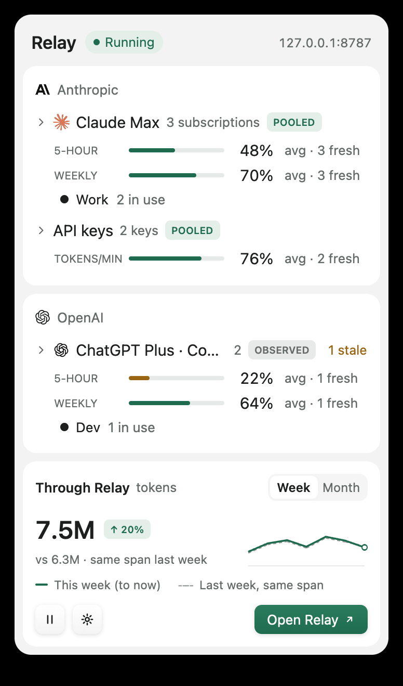
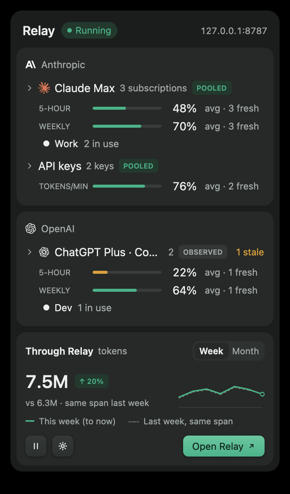

# relay-desktop

The `relay` binary is the GPUI tray popover and main window for Relay on
macOS and Linux. It renders snapshots from the local proxy and never sits on
the request path.

<p>
  
  
</p>

<sub><b>Offscreen renders of this crate's code, with fixture data.</b>
`tests/render.rs` draws them through GPUI's headless Metal renderer. They
aren't captures of a live session: the accounts and numbers are fixtures shaped
like the Paper design samples. The approved designs are in
`design/screenshots/final/`.</sub>

## Structure

| Module                                               | Role                                                                                                                         |
| ---------------------------------------------------- | ---------------------------------------------------------------------------------------------------------------------------- |
| `main.rs`, `cli.rs`                                  | Handles `--version` and `--help` before any GPUI, tray, proxy or file access.                                                |
| `app.rs`                                             | Accessory app (no Dock icon), status item, popover window lifecycle, and Open Relay focusing the main window.                |
| `bridge.rs`                                          | Thread that owns `relay_proxy::Handle`, `ConfigStore` and `relay_usage::Reader`, and sends ready-made view models to the UI. |
| `adapter.rs`                                         | Pure mapping from the `relay_core` snapshot and `ThroughRelay` to `model.rs`.                                                |
| `tray.rs`                                            | `tray-icon` status item, template glyph, board 7 native menu and popover anchor.                                             |
| `popover.rs`, `through.rs`, `chart.rs`               | Boards 1, 2, 6 and 9: popover, Through Relay block and sparkline.                                                            |
| `dashboard.rs`                                       | Main window with title-bar tabs.                                                                                             |
| `quotas.rs`, `accounts.rs`, `usage.rs`, `routing.rs` | Boards 3, 4 and 5. `accounts.rs` also holds the connect sheet.                                                               |
| `widgets.rs`, `motion.rs`, `theme.rs`                | Tactile buttons, tags, bars, segmented control, switch, interruptible tweens and tokens.                                     |
| `input.rs`                                           | Single-line text field adapted from GPUI's `examples/input.rs` (Apache-2.0).                                                 |
| `login.rs`                                           | Open at login: a LaunchAgent on macOS or an XDG autostart entry on Linux, written only when the user toggles it.             |

## Runtime behaviour

- **Threads:** GPUI owns the main thread. The proxy runs on its own Tokio
  runtime. The bridge thread waits on UI commands and on the proxy's `watch`
  channel, so it does no work while idle. Every SQLite read runs on the bridge
  thread, never during render.
- **No idle redraw:** animations request frames only while a tween is moving.
  While the popover or main window is open, a 30 s task asks the bridge to
  re-evaluate relative times such as "resets in". It ends when the view closes.
- **Truthful states:**
  - Unknown values show "—", never 0%.
  - Stale values are dimmed, labelled "not in avg" and left out of averages.
  - If the proxy can't bind, Relay lists the configured accounts with unknown
    quota and offers Try again and Change port. Change port opens Routing,
    where a validated port (1024–65535) is saved and the proxy restarts on it,
    draining in-flight requests and keeping the routing pause.
  - Reset limits and Refresh quota are disabled, with the reason core reports.
- **Accounts:** the connect sheet stores credential references only (a login
  file path or an environment variable name) and masks identifiers before
  saving. Relay never reads or changes T3 settings. Setup values are shown for
  copying, with the local key as a placeholder. Each account row offers one action: Resume (paused), Reconnect (opens the
  connect sheet on its setup step) or a quiet Pause (no new router-owned
  sessions; observed clients keep passing). Settings changes are sent as
  single-field edits that the bridge applies to its canonical config, so a
  stale UI copy can't drop an account or revert a pause. Connect advances only after the bridge confirms the save. Every connect
  request and reply carries an operation id, so a late reply can't move or
  cancel the sheet. After Back, Continue merges only the sheet's fields
  (label, identifier, mode, credential reference) onto the saved account. The
  provider is locked, and plan, upstream, models, concurrency and pause are
  untouched. Reconnect has no Back, and it counts only requests newer than
  when it opened. A command that can't reach the runtime shows its reason
  instead of waiting.
- **Motion:** every animation uses ease-out `cubic-bezier(0.23, 1, 0.32, 1)`
  and lasts at most 300 ms. Reversing mid-animation starts from the current
  value. Reduced motion is read from the OS off the UI thread.
  - Buttons press on the same frame and sink 1 px.
  - The popover opens with a fade and a 4 px drop.
  - Groups expand by animating to their measured height.
  - Week/Month slides the pill (160 ms) and crossfades the sparkline by
    opacity (120 ms). Values aren't interpolated, and reduced motion swaps
    instantly.

## Checks

Run from the workspace root with rustup's 1.98.1 toolchain first in `PATH`.
Homebrew's `cargo` ignores `rust-toolchain.toml`.

```sh
export PATH="$HOME/.rustup/toolchains/1.98.1-aarch64-apple-darwin/bin:$PATH"
cargo fmt -p relay-desktop --check
cargo clippy -j4 -p relay-desktop --all-targets -- -D warnings
cargo test -j4 -p relay-desktop        # unit tests + offscreen render
```

`tests/render.rs` runs without the libtest harness, because AppKit needs the
main thread. It renders 18 views, light and dark: five popover states and
four main-window tabs. One popover state is a long-title stress case: a
pixel column inside the sections' right inset must contain only tonal
surface colours. The test also checks the panel background against the theme
tokens and writes PNGs to `target/relay-snapshots/`. It shows no
window, takes no focus, adds no Dock icon, and touches no network, port or
user file. On Linux it prints `SKIP`.

### Non-disruptive testing

Don't start `relay` without arguments on a machine someone is using: it adds
a status item and starts the proxy on 127.0.0.1:8787. Locally, run only
`relay --version`, `relay --help` and the tests above. Desktop automation
(clicks, AppleScript, focus changes) is out of bounds. Startup smoke tests
belong on isolated CI runners with `RELAY_HOME` set to a temporary directory.

## Platform notes

- **macOS:** the status item comes from `tray-icon` 0.26.1 inside GPUI's
  NSApp run loop. A synthetic click opened a GPUI pop-up window during the
  prototype, before the non-disruptive-testing rule applied. Shaders compile
  at launch (`runtime_shaders`), so a build needs Xcode but not the separately
  downloaded Metal Toolchain.
- **Linux:** the StatusNotifierItem comes from `tray-icon`'s `ksni` backend.
  Left-click (`Activate`) opens the popover and right-click opens the native
  menu. Hosts that send zero coordinates get the popover at the top right.
  - Wayland compositors may place the window themselves.
  - GNOME needs the AppIndicator extension. Without a status-item host, Relay
    opens the main window instead of exiting.
  - The Linux build is compiled only in CI. Linux rendering and tray behaviour
    are unverified here.
- **Not yet verified:**
  - Live frame-rate acceptance: 120 fps on macOS, 60 fps on Linux.
  - VoiceOver and AT-SPI output. Roles, labels and expanded/selected states
    are set through GPUI's AccessKit API.
  - Popover window resizing on a real display.
  - GPUI has no general element scale transform, so the popover open omits
    the 98→100 % scale from the motion spec. It uses fade and drop only.
